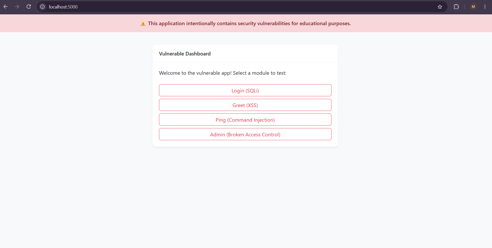
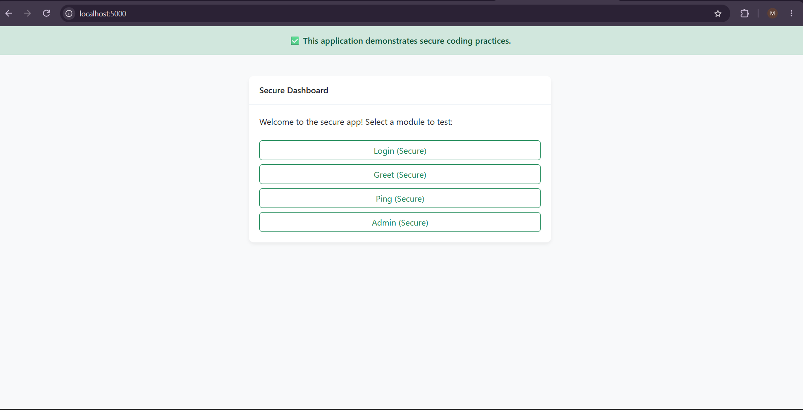
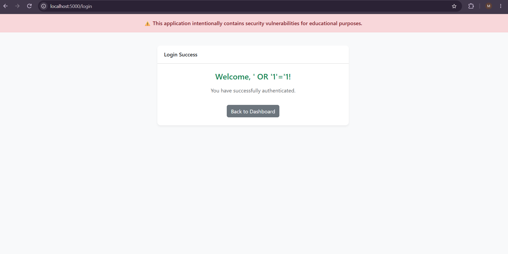
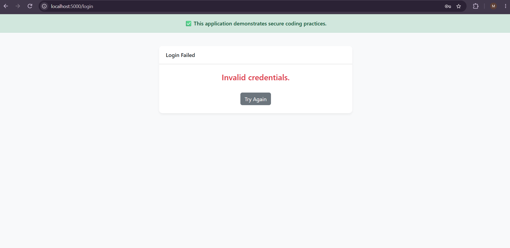
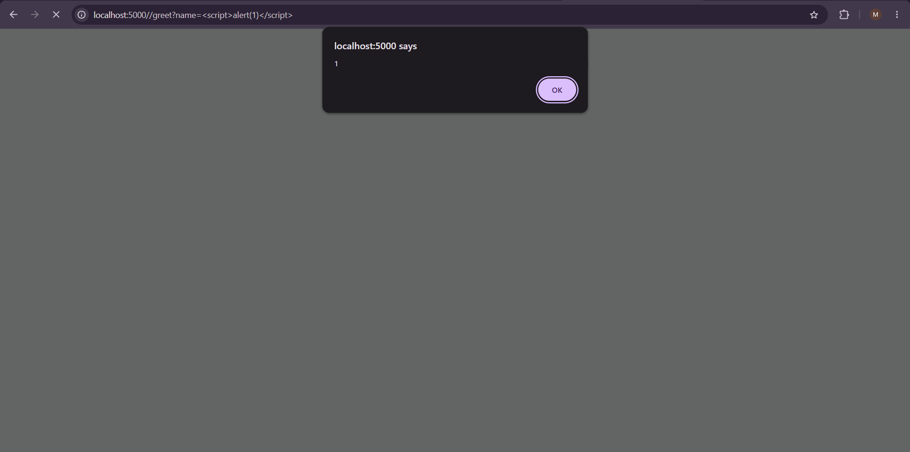
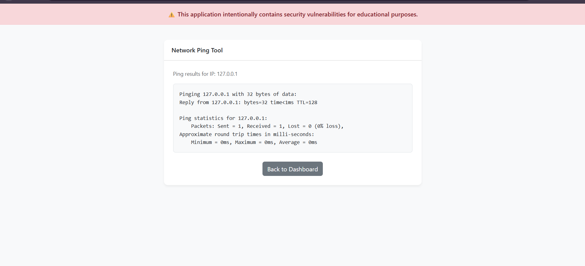
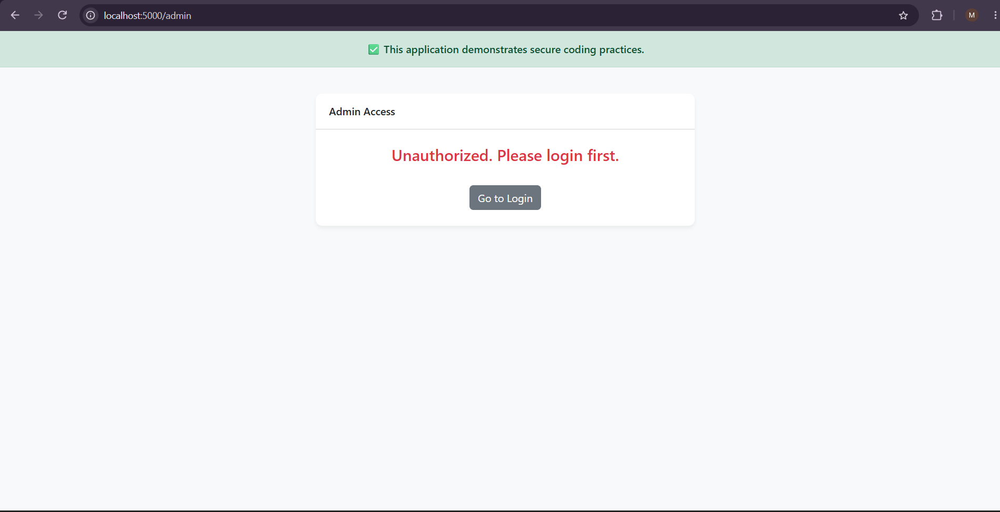
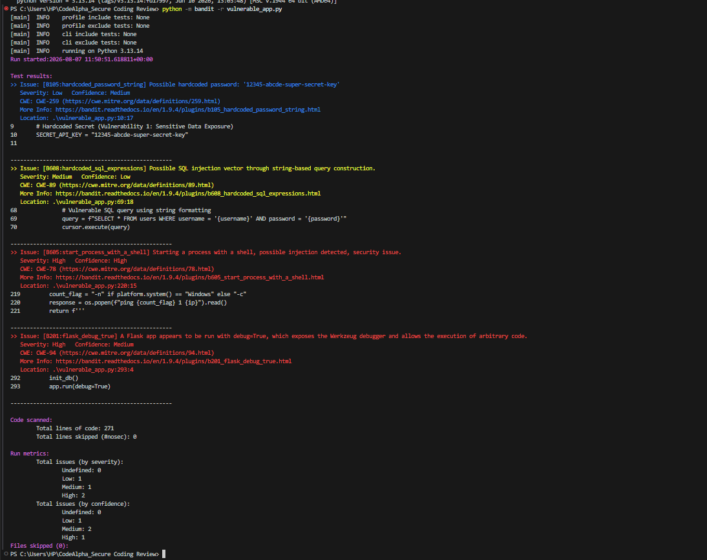

# 🛡️ Secure Coding Review (CodeAlpha)


A comprehensive Secure Coding Review project developed for **CodeAlpha**. This repository demonstrates common web application vulnerabilities and their corresponding secure implementations using Python and Flask. It includes a vulnerable application, a remediated secure application, and an in-depth security audit report.

## 📑 Table of Contents
- [Project Overview](#-project-overview)
- [Vulnerabilities Explored](#-vulnerabilities-explored)
- [Repository Structure](#-repository-structure)
- [Tools Used](#-tools-used)
- [Getting Started](#-getting-started)
- [Usage](#-usage)
- [Disclaimer](#-disclaimer)

## 🎯 Project Overview
The goal of this project is to perform a manual and automated code review to identify security flaws in a web application and provide actionable remediation steps. 
Two versions of a Flask application are provided:
1. **`vulnerable_app.py`**: Intentionally includes critical security flaws.
2. **`secure_app.py`**: The patched version adhering to secure coding best practices.

A detailed **[Code Review Report](Code_Review_Report.md)** is included, detailing findings, risks, and fixes.

## 🐛 Vulnerabilities Explored
This project covers the following critical vulnerabilities (inspired by the OWASP Top 10):
1. **Hardcoded Secrets (Sensitive Data Exposure)**
2. **SQL Injection (SQLi)**
3. **Cross-Site Scripting (Reflected XSS)**
4. **Command Injection**
5. **Plaintext Passwords (Weak Cryptography)**
6. **Missing Authentication (Broken Access Control)**

## 📸 Screenshots & Demonstrations

### 🟥 Vulnerable Dashboard


### 🟩 Secure Dashboard


### 🐛 Vulnerability Demonstrations

**1. SQL Injection (SQLi)**


**2. SQL Injection Fixed (Parameterized Queries)**


**3. Cross-Site Scripting (XSS)**


**4. Command Injection**


**5. Missing Authentication Fixed**


### 🛡️ Static Analysis (Bandit)


## 📂 Repository Structure
```text
📦 CodeAlpha_Secure_Coding_Review
 ┣ 📜 vulnerable_app.py      # The intentionally vulnerable Flask application
 ┣ 📜 secure_app.py          # The remediated, secure Flask application
 ┣ 📜 Code_Review_Report.md  # Detailed security audit report and remediation steps
 ┣ 📜 bandit_report.txt      # Static Application Security Testing (SAST) results
 ┣ 📜 requirements.txt       # Python dependencies
 ┗ 📜 README.md              # Project documentation
```

## 🛠️ Tools Used
- **Language:** Python 3
- **Web Framework:** Flask, Werkzeug
- **Database:** SQLite3
- **Static Analysis (SAST):** Bandit (Python security linter)

## 🚀 Getting Started

### Prerequisites
Ensure you have Python 3.8+ installed on your machine.

### Installation
1. Clone this repository:
   ```bash
   git clone https://github.com/rohans37/CodeAlpha_SecureCodingReview.git
   cd CodeAlpha_SecureCodingReview
   ```

2. (Optional but recommended) Create a virtual environment:
   ```bash
   python -m venv venv
   source venv/bin/activate  # On Windows use `venv\Scripts\activate`
   ```

3. Install the required dependencies:
   ```bash
   pip install -r requirements.txt
   ```

## 💻 Usage

### Running the Vulnerable App
```bash
python vulnerable_app.py
```
*The app will run on `http://127.0.0.1:5000`. You can test SQL injection on `/login`, command injection on `/ping`, and bypass authentication on `/admin`.*

### Running the Secure App
```bash
# Set a secure environment variable for the secret key (optional)
export SECRET_KEY="your-super-secret-key" # On Windows use: set SECRET_KEY="your-super-secret-key"

python secure_app.py
```
*The secure app mitigates the vulnerabilities. Passwords are hashed using PBKDF2, inputs are sanitized and parameterized, and unauthorized access is blocked.*

### Running Static Analysis (Bandit)
To run the Bandit SAST tool against the vulnerable code yourself:
```bash
pip install bandit
bandit -r vulnerable_app.py
```

## ⚠️ Disclaimer
**Educational Purposes Only:** The `vulnerable_app.py` script contains intentional, critical security vulnerabilities. Do NOT deploy or run the vulnerable application in a production environment or on a public-facing server. This repository is intended strictly for educational purposes and security research.
